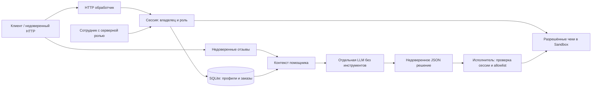

# Модель угроз Mini Shop

Область: собственный процесс на 127.0.0.1, синтетические профили и одноразовые файлы. Внешние системы не являются целями. `sandbox.py` не изменён.

Активы: изоляция клиентов, профили, заказы, цена каталога, чеки, служебная заметка, учётные данные, доступность процесса. Противник: анонимный клиент, клиент alice против bob, автор отзыва, модель с ошибочным решением. Заголовки, идентификаторы, JSON, отзывы и решения модели не являются источниками полномочий.

| STRIDE | Угроза | Защита и проверка |
|---|---|---|
| Подмена | X-Role, чужие идентификаторы | Роль и владелец из сессии; тесты forged_role, foreign_access |
| Изменение | SQL-инъекции, цена клиента | Параметры SQLite, цена каталога; sql_injection, price_is_catalog |
| Отказ от действий | Журнал без безопасного аудита | Ограниченный журнал маршрутов без секретов; полноценный аудит вне учебного объёма |
| Раскрытие | Чужие профили, заказы, файлы, токены | Проверки владельца; журнал только сотруднику, без тела и заголовков |
| Отказ в обслуживании | Большие тела, отзывы, накопление объектов, медленный ввод | Лимит тела 64 KiB, таймаут чтения, лимиты отзывов/заказов/сессий/журнала; ограничение login |
| Повышение полномочий | Prompt injection и опасные инструменты | Недоверенный контекст, строгая схема решения, запрет export/delete для помощника, allowlist чеков |
| Изменение/раскрытие | Сохранённый XSS | HTML escaping, CSP, nosniff; xss_escaped |

Сотрудник может экспортировать профили, видеть заказы и читать чеки через авторизованные API. Помощнику не требуется удалять файлы или экспортировать профили даже от имени сотрудника. Публичны только здоровье, каталог, вход и безопасное отображение отзывов.

Остаточные ограничения: учебные пароли в исходниках, HTTP на loopback, память без постоянного аудита, общий лимит входов допускает временную блокировку другими локальными клиентами, ThreadingHTTPServer не ограничивает число одновременно открытых соединений. Это локальная лаборатория, не production-развёртывание. Подключение реальной LLM передаёт синтетический контекст провайдеру; приложение само внешних запросов не делает. Prompt injection не устраняется одним текстом: безопасность обеспечивает исполнитель независимо от ответа модели.
