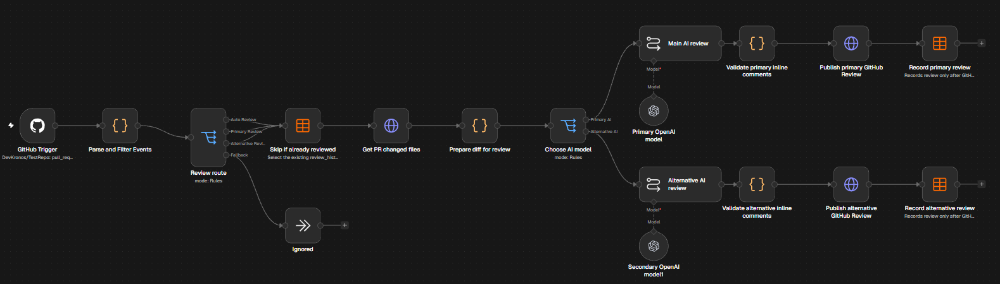
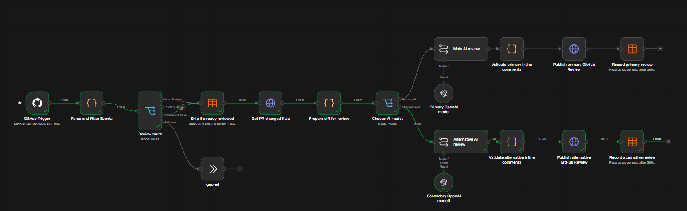
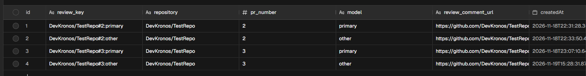
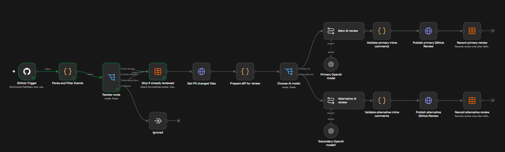
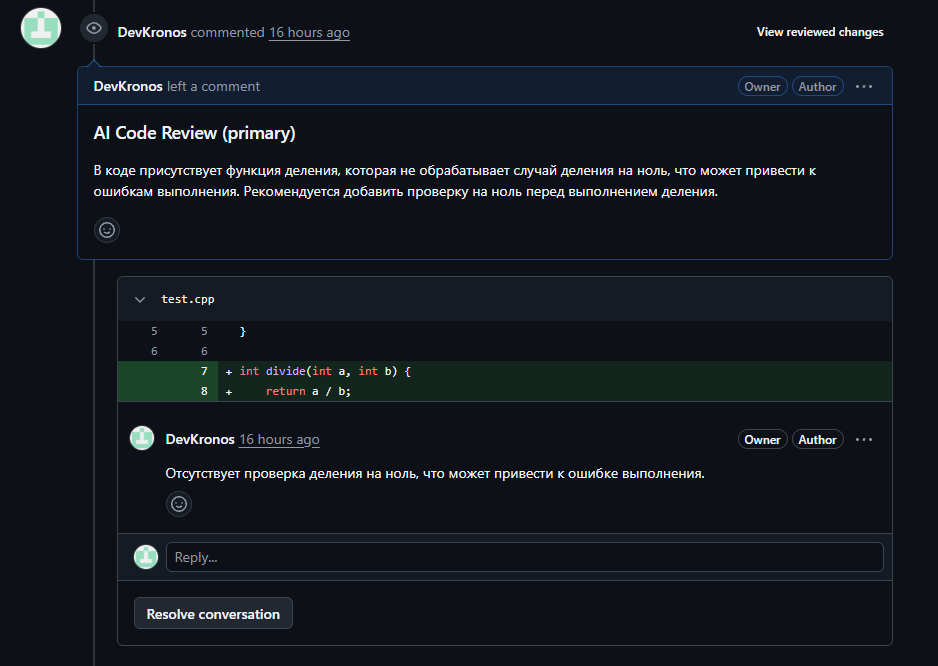

# Отчёт по практической работе 7.1

**Тема:** Разработка AI-ассистента для код-ревью в n8n.

## 1. Цель работы

Разработать автоматизированный сценарий код-ревью с использованием платформы n8n, языковых моделей и GitHub API.

Реализовать возможность выбора модели, сохранение истории выполненных проверок, предотвращение повторного ревью и публикацию комментариев к конкретным строкам изменённого кода.

## 2. Реализация

### 2.1. Общая архитектура

Разработан workflow, который получает события из GitHub с помощью GitHub Trigger.

При открытии Pull Request запускается автоматическое ревью. Также предусмотрен ручной запуск через комментарии к PR:

- `/make_ai_review` — запуск основной модели;
- `/make_other_ai_review` — запуск альтернативной модели.

Поступившее событие обрабатывается и направляется по соответствующему маршруту с помощью Switch.

Перед выполнением ревью проверяется наличие записи о PR в Data Table. Если повторная проверка не требуется, через GitHub API запрашиваются изменённые файлы и формируется diff.

Полученные изменения передаются языковой модели, которая анализирует код и формирует замечания. После проверки корректности координат комментарии публикуются в GitHub Pull Request Review.

После успешной публикации сведения о выполненном ревью сохраняются в Data Table.

### 2.2. Использование второй языковой модели

Для выбора модели реализована маршрутизация в зависимости от поступившей команды.

Команда `/make_other_ai_review` направляет выполнение на альтернативную языковую модель, отличную от основной. Результат анализа публикуется в соответствующем Pull Request.

Работа альтернативной модели проверена посредством выполнения команды в комментарии к тестовому PR.

### 2.3. Сохранение истории ревью

Для хранения информации о выполненных проверках создана Data Table `review_history`.

Таблица содержит следующие поля:

| Поле | Назначение |
|---|---|
| `review_key` | Уникальный ключ проверки PR выбранной моделью |
| `repository` | Название репозитория |
| `pr_number` | Номер Pull Request |
| `model` | Использованная модель |
| `review_comment_url` | Ссылка на опубликованное ревью |

Запись добавляется после успешного выполнения ревью. Это позволяет определить, какие PR уже были проверены.

### 2.4. Предотвращение повторного ревью

Перед запуском языковой модели workflow проверяет наличие соответствующей записи в `review_history`.

Если PR уже был проверен основной моделью, повторный комментарий `/make_ai_review` не приводит к новому анализу кода.

При этом история основной и альтернативной моделей учитывается раздельно, поэтому использование второй модели возможно после завершения первой проверки.

Работа механизма проверена повторным отправлением команды `/make_ai_review` в ранее проверенный PR. Выполнение завершилось на этапе проверки Data Table без повторного вызова языковой модели.

### 2.5. Точечные комментарии к коду

Для публикации замечаний непосредственно к изменённым строкам реализована дополнительная обработка diff.

Перед передачей изменений языковой модели формируется представление diff с указанием номеров строк.

Модель возвращает структурированный результат, содержащий общее заключение и список замечаний. Каждое замечание включает:

- путь к файлу;
- номер строки;
- текст комментария.

Перед публикацией workflow проверяет соответствие указанного файла и строки реальному diff. Некорректные координаты отбрасываются.

Для публикации используется GitHub Pull Request Reviews API, позволяющий создавать ревью с комментариями, привязанными к конкретным строкам.

Работоспособность подтверждена на тестовом PR: замечание о возможном делении на ноль опубликовано непосредственно возле соответствующей строки кода.

## 3. Результаты тестирования

**Тестовый репозиторий:** [DevKronos/TestRepo](https://github.com/DevKronos/TestRepo)

**Тестовый Pull Request:** [PullRequest](https://github.com/DevKronos/TestRepo/pull/3)

| Проверяемая функциональность | Результат |
|---|---|
| Автоматическое ревью при открытии PR | Успешно |
| Запуск основной модели через `/make_ai_review` | Успешно |
| Запуск альтернативной модели через `/make_other_ai_review` | Успешно |
| Сохранение истории в Data Table | Успешно |
| Блокировка повторного ревью | Успешно |
| Публикация точечных комментариев | Успешно |

В ходе тестирования подтверждена работоспособность основных компонентов сценария, включая интеграцию с GitHub, вызов языковых моделей, хранение состояния и публикацию результатов анализа.

## 4. Вывод

В ходе практической работы разработан AI-ассистент для автоматизированного код-ревью на платформе n8n.

Реализованы автоматический и ручной запуск анализа Pull Request, выбор между двумя языковыми моделями, сохранение истории проверок и предотвращение повторного ревью.

Дополнительно реализована публикация замечаний к конкретным строкам изменённого кода с предварительной проверкой корректности их расположения в diff.

В результате получен работающий сценарий, позволяющий автоматизировать первичную проверку изменений в GitHub и сократить количество повторных обращений к языковым моделям.