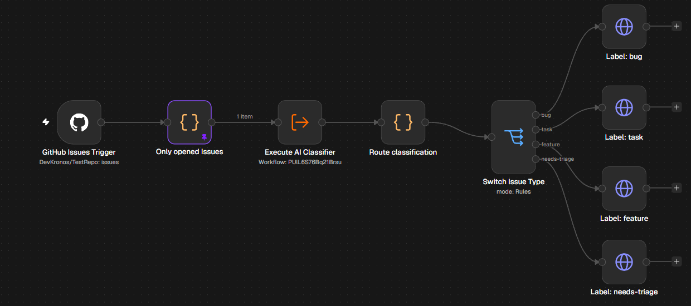
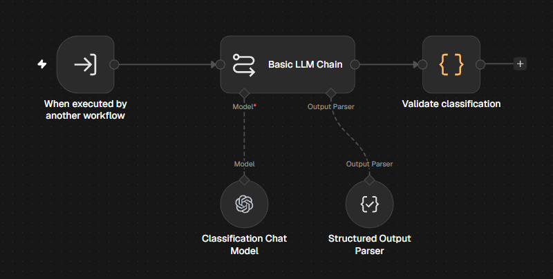
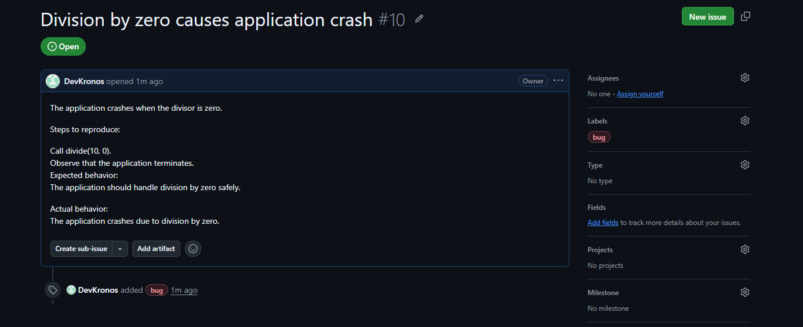
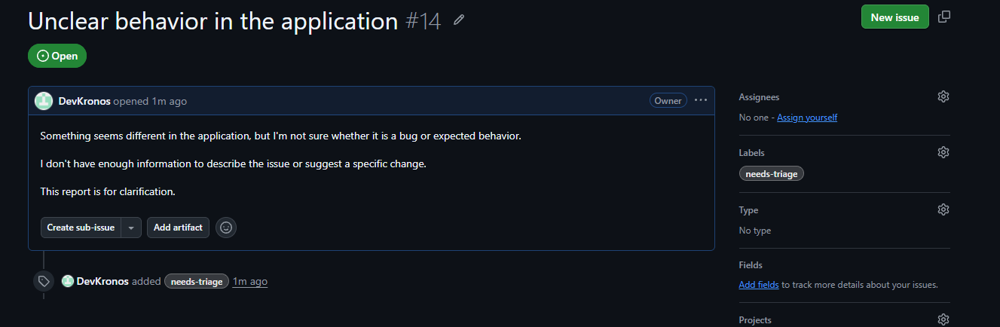
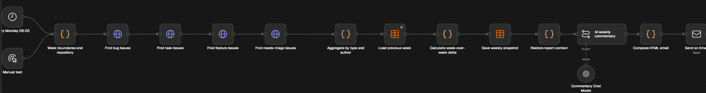
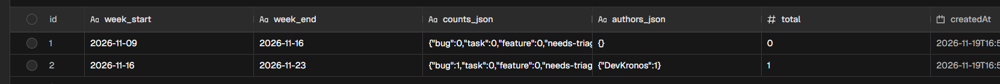
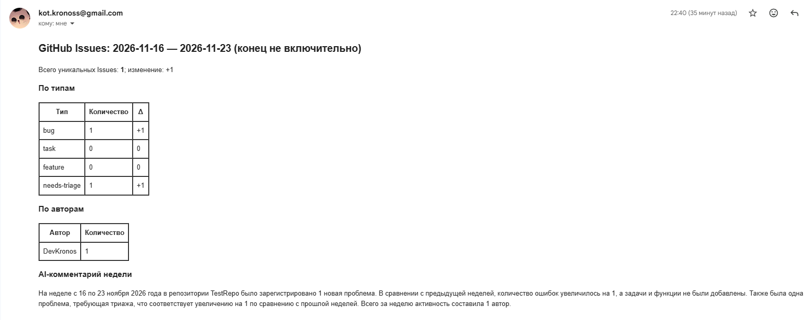

# Отчёт по практической работе 7.2

**Тема:** Автоматизация обработки GitHub Issues с использованием ИИ и n8n.

## 1. Цель работы

Разработать автоматизированные сценарии обработки GitHub Issues с использованием платформы n8n, языковых моделей и GitHub API.

Реализовать классификацию обращений пользователей, обработку случаев с низкой уверенностью классификации, сбор еженедельной статистики, сохранение истории и генерацию аналитических отчётов.

## 2. Реализация

### 2.1. Автоматическая классификация Issues

Разработан workflow, который отслеживает создание новых GitHub Issues с помощью GitHub Trigger.

При получении события проверяется, что его тип соответствует `opened`. После этого заголовок и описание Issue передаются в отдельный Sub-workflow для классификации.

Классификатор определяет одну из категорий:

- `bug` — сообщение об ошибке;
- `task` — задача;
- `feature` — предложение новой функциональности;
- `unknown` — неопределённая категория.

Для каждой классификации модель возвращает категорию `type` и значение уверенности `confidence` в диапазоне от 0 до 1.

Если уверенность составляет не менее 0.8 и категория определена, Issue получает соответствующую метку. В остальных случаях назначается метка `needs-triage` для последующей ручной обработки.

Для маршрутизации используется Switch с именованными выходами. Метки назначаются через GitHub API.

### 2.2. Выделение классификатора в Sub-workflow

Логика классификации вынесена в отдельный workflow, вызываемый из основного сценария через `Execute Sub-workflow`.

Sub-workflow принимает два параметра:

- `title` — заголовок Issue;
- `body` — описание Issue.

Для анализа текста используется `Basic LLM Chain` с подключённой языковой моделью.

`Structured Output Parser` задаёт структуру ответа, содержащую категорию и уверенность классификации.

Дополнительный узел `Validate classification` проверяет полученный результат и приводит его к ожидаемой структуре.

Выделение классификатора в отдельный workflow позволяет независимо изменять модель и промпт, не затрагивая остальные узлы обработки GitHub Issues.

### 2.3. Проверка классификации

Для проверки автоматической классификации был создан GitHub Issue с сообщением об ошибке деления на ноль.

Модель определила обращение как `bug`, после чего основной workflow автоматически назначил соответствующую метку.

Отдельно проверена обработка неоднозначного обращения, в котором недостаточно информации для уверенного определения категории.

Для такого Issue workflow выбрал маршрут `needs-triage` и автоматически назначил одноимённую метку. Комментарий в GitHub при этом не публиковался.

### 2.4. Еженедельная статистика GitHub Issues

Разработан отдельный workflow для автоматического сбора статистики по GitHub Issues.

Сценарий запускается по расписанию каждый понедельник в 09:00 с помощью `Schedule Trigger`.

Через GitHub API выполняются четыре запроса для получения обращений по категориям. Полученные данные обрабатываются и объединяются с устранением повторного учёта одинаковых Issues.

Для каждого отчётного периода вычисляются:

- количество уникальных Issues;
- количество обращений по категориям;
- количество обращений по авторам;
- изменения относительно предыдущей недели.

Сформированные данные используются для построения еженедельного отчёта.

### 2.5. Сохранение и сравнение статистики

Для хранения истории создана Data Table `weekly_statistics`.

Таблица содержит следующие поля:

| Поле | Назначение |
|---|---|
| `week_start` | Начало отчётной недели |
| `week_end` | Конец отчётного периода |
| `counts_json` | Статистика по категориям Issues |
| `authors_json` | Статистика по авторам |
| `total` | Общее количество уникальных Issues |

При формировании отчёта workflow загружает данные предыдущей недели и вычисляет изменения показателей.

Для сохранения текущей статистики используется операция `Upsert`, предотвращающая появление нескольких записей за один отчётный период.

В ходе тестирования были сохранены данные за две недели:

| Период | Уникальных Issues |
|---|---:|
| 09.11.2026–15.11.2026 | 0 |
| 16.11.2026–22.11.2026 | 1 |

При сравнении периодов выявлено увеличение общего количества Issues на 1.

Повторный запуск сценария для того же периода не привёл к созданию дублирующей записи.

### 2.6. Формирование и отправка HTML-отчёта

На основе собранной статистики workflow формирует HTML-письмо, содержащее:

- отчётный период;
- общее количество Issues;
- таблицу количества обращений по категориям;
- изменение показателей относительно предыдущей недели;
- статистику по авторам;
- аналитический комментарий языковой модели.

Для генерации аналитического комментария используется отдельный вызов языковой модели. На вход передаются показатели текущего и предыдущего отчётных периодов.

Модель формирует текстовое описание произошедших изменений.

Отправка отчёта реализована через узел `Send Email` с использованием SMTP-сервера Gmail. Такой подход позволяет отправлять HTML-письма без использования Google Cloud и Gmail API.

В ходе тестирования письмо было успешно отправлено и получено. Корректность отображения таблиц и аналитического комментария подтверждена.

## 3. Результаты тестирования

**Тестовый репозиторий:** [DevKronos/TestRepo](https://github.com/DevKronos/TestRepo)

**Issue с категорией bug:** [Issue #10](https://github.com/DevKronos/TestRepo/issues/10)

**Issue для ручной классификации:** [Issue #14](https://github.com/DevKronos/TestRepo/issues/14)

| Проверяемая функциональность | Результат |
|---|---|
| Автоматическое получение новых GitHub Issues | Успешно |
| Классификация с помощью языковой модели | Успешно |
| Использование отдельного Sub-workflow | Успешно |
| Автоматическое назначение меток | Успешно |
| Обработка неопределённых обращений через `needs-triage` | Успешно |
| Получение статистики через GitHub API | Успешно |
| Группировка по категориям и авторам | Успешно |
| Сохранение истории в Data Table | Успешно |
| Предотвращение дублирования недельных записей | Успешно |
| Сравнение показателей двух недель | Успешно |
| Генерация AI-комментария | Успешно |
| Формирование и отправка HTML-письма | Успешно |

Проверка еженедельной статистики выполнялась с ручным запуском workflow и временным заданием тестового отчётного периода. После завершения тестирования восстановлено автоматическое определение предыдущей завершённой недели. Запуск workflow настроен на каждый понедельник в 09:00.

## 4. Вывод

В ходе практической работы разработана система автоматизированной обработки GitHub Issues на платформе n8n.

Реализована классификация обращений с помощью языковой модели, включая отдельный Sub-workflow и механизм передачи неоднозначных обращений на ручную обработку.

Также разработан сценарий еженедельного анализа Issues, обеспечивающий сбор статистики, группировку по категориям и авторам, сохранение истории и сравнение показателей разных недель.

На основе полученных данных формируется HTML-отчёт с аналитическим комментарием ИИ, который автоматически отправляется по электронной почте.

В результате автоматизированы основные этапы первичной обработки пользовательских обращений и формирования регулярной аналитической отчётности.